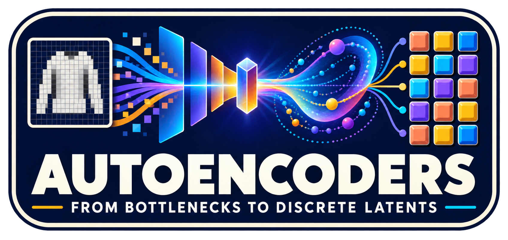

<p align="center">
  
  <br />
  <!-- repo-tagline:start -->
  <strong>🧪 Learn autoencoders by predicting, running, and inspecting experiments 🧪</strong>
  <!-- repo-tagline:end -->
</p>

Learn autoencoders, VAEs, and VQ-VAEs through 14 executable Python notebooks.
Predict what an experiment will do, run it, and inspect the result.

## Start the course

[Open Lesson 00 in Colab](https://colab.research.google.com/github/tsilva/course-aiml-autoencoders/blob/main/course/notebooks/00-laboratory.ipynb).
Run **Set up the course**, then follow the encoder, bottleneck and decoder
cells to see how the model reconstructs an image. The
[curriculum](https://github.com/tsilva/course-aiml-autoencoders/blob/main/docs/curriculum.md)
links all 14 lessons in order.

## Run locally

With Python 3.11–3.13 and uv, run from the checkout:

```bash
uv sync --frozen
uv run --frozen python -m jupyterlab course/notebooks/00-laboratory.ipynb
```

Open the printed URL. Lessons default to short CPU runs. Fashion-MNIST
downloads on first use, and experiment output stays under `runs/`.

See the [course guide](https://github.com/tsilva/course-aiml-autoencoders/blob/main/course/README.md)
for experiments and authoring and
[troubleshooting](https://github.com/tsilva/course-aiml-autoencoders/blob/main/course/TROUBLESHOOTING.md)
for setup or training problems.

## License

[MIT License](https://github.com/tsilva/course-aiml-autoencoders/blob/main/LICENSE).
